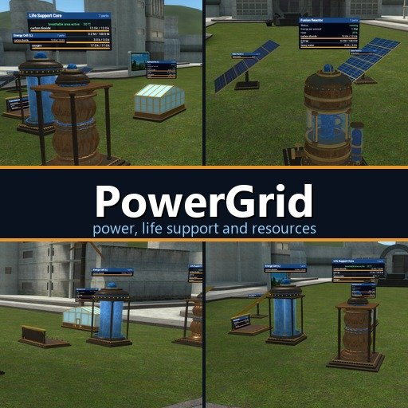
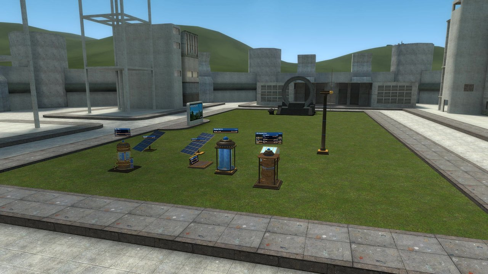
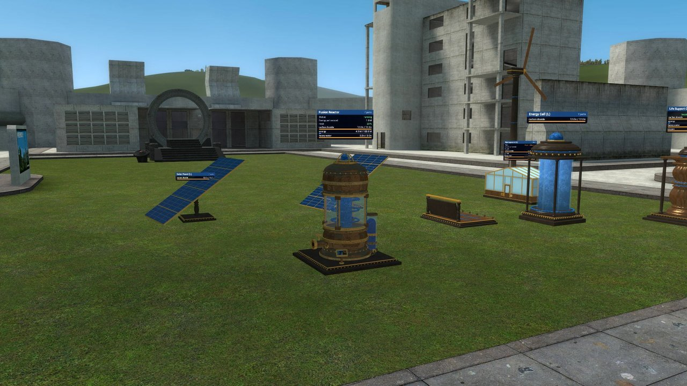
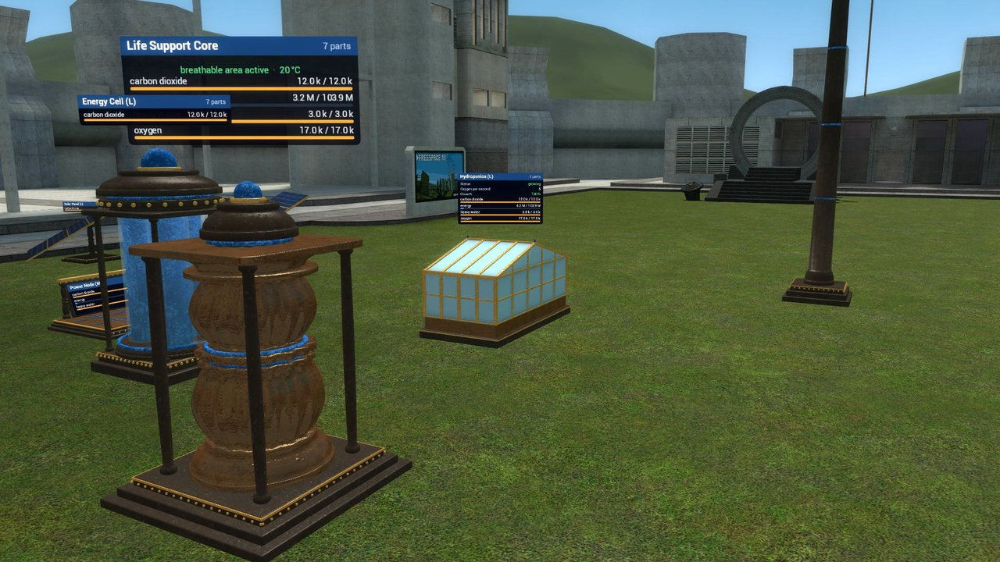
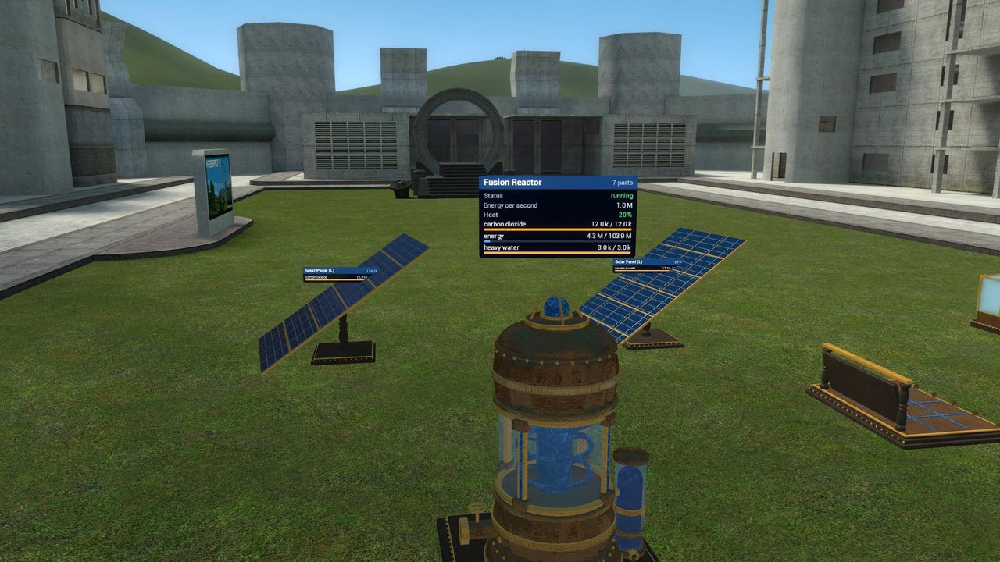
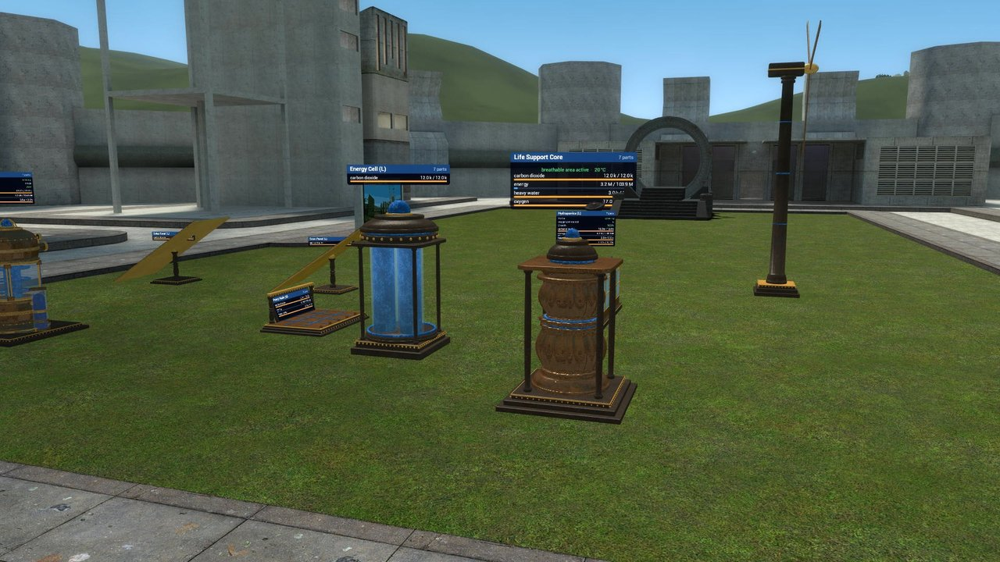
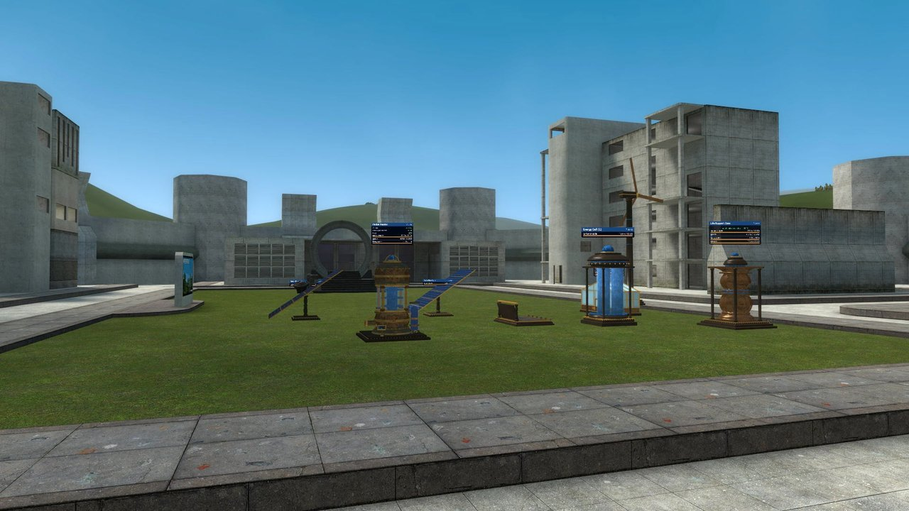

# PowerGrid - Resource Network & Life Support

> Energy, air and water for everything you build. Light on the server, simple to wire up.

PowerGrid is a resource network for Garry's Mod. Place a generator, a cell and a node, link them, and your build has power. Take it to space and it keeps you alive there too. It works on its own, and any addon can plug into it.

## Install
**Steam Workshop (easiest):** subscribe [there](https://steamcommunity.com/sharedfiles/filedetails/?id=3840679072).

**By hand:** download `powergrid-1.0.1.zip` from [Releases](../../releases/latest) and unpack it into
`garrysmod/addons/` (you get the folder `garrysmod/addons/powergrid`).

## Bugs, problems and wishes
Please use [Issues](../../issues): pick *Bug report* or *Wish or idea*. On the Steam Workshop page the comments work too.

## Pictures
<p>






</p>

---

## What's inside

### Energy
- Solar panels (they need open sky), a wind turbine (the higher, the better), fusion reactor, hydro generator, steam turbine
- A heavy water extractor that makes the fusion reactor's fuel
- Energy cells from XS to XL, power nodes, power displays
- A power valve to join or split two networks
- Resource tanks for oxygen, water, nitrogen, hydrogen and more

### Life support
- Life support core: air and a pleasant climate for a whole StarCore ship, or a bubble of air on open ground
- Every player wears a space suit, with a small HUD that only shows up when something is wrong
- Suit dispenser, heaters and coolers, air compressor (oxygen or nitrogen), water pump, water splitter, fuel cell, ram scoop
- Air and water go round: people breathe out carbon dioxide, hydroponics turn it back into oxygen, a fuel cell makes water from hydrogen
- Hydroponics, environment probe, terraformer, gravity regulator
- A space simulation with planets - or Spacebuild's own, when Spacebuild runs

### Tools
- **PowerGrid Parts**: every part in one picture grid, with a ghost preview before you place it
- **PowerGrid Connector**: click the parts, click the node, done
- Linking by hand, automatically for welded parts, or a mix - the admin decides

---

## Required
Nothing. PowerGrid works alone.
- With **Spacebuild / CAF** installed it uses Spacebuild's Resource Distribution, so old builds keep working. The setting "Always PowerGrid" switches back to its own network.
- **Ascension Gates**, **StarCore**, **Black Hole Cache** and **SpaceGrid** build on it: [Ascension Gates - Complete](https://steamcommunity.com/sharedfiles/filedetails/?id=3840681489)

## First steps
1. Q > tools on the right > the **PowerGrid** tab > **PowerGrid Parts**.
2. Place a solar panel, an energy cell and a power node.
3. Take the **PowerGrid Connector**: left click the panel and the cell, right click the node.
4. Look at the node: its display shows the energy coming in.

Settings: Q > tools on the right > the **PowerGrid** tab > Settings > PowerGrid.

## For addon makers
```lua
PowerGrid.SetupEntity(ENT)          -- AddResource, GetResource, ConsumeResource, SupplyResource, Wire helpers
PowerGrid.AddSpawn(class, group, order) -- your entity in the PowerGrid spawn tab
```

## Privacy
PowerGrid collects nothing. From the Workshop it never goes online - Steam keeps it up to date. Installed by hand from GitHub, it has a "Check for updates" button in its About panel: that asks GitHub for the newest version number and sends nothing about you.

---

## Power the people
> Every part on this page needs energy. So does the person who made it.

If PowerGrid keeps your builds running, a small tip keeps me running:
[](https://www.paypal.me/soulridejourney)
A thumbs-up and a favourite help a lot too.

---

## Licence
MIT - free to use, change and share; keep the licence and the author's name. All code, models and textures are original work.

## Credits
Written for Ascension Gates by moonrise420. The ideas follow Spacebuild / CAF Resource Distribution - none of their code or assets are included.
